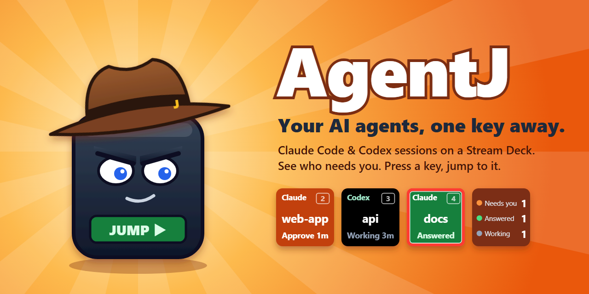
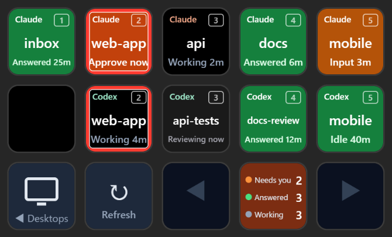
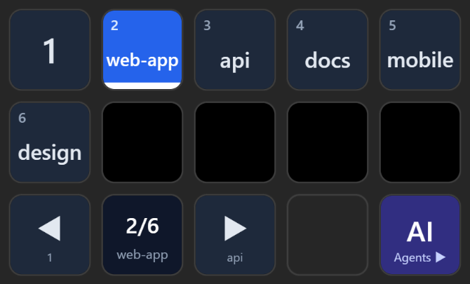

# AgentJ



**Claude Code と Codex のセッションを Stream Deck のキーに1つずつ並べ、押すとそのセッションへ飛ぶ。**

[English](README.md)

AgentJ は、オープンソースの Stream Deck アプリ [OpenDeck](https://github.com/nekename/OpenDeck) のプラグインです。
AI コーディングエージェントを同時にいくつも動かし、Windows 11 の仮想デスクトップごとに1つのプロジェクトを置いて
作業する人に向けて作っています。

- Claude Code / Codex のセッションごとに1つのキーを使い、名前、デスクトップ、状態（承認待ち・返答済み・作業中・
  エラー、Claude Code ではさらに入力待ち（MCP のフォームやリンク）とバックグラウンド処理中（ターンは終わったが、
  始めたバックグラウンドのコマンドやサブエージェントがまだ動いている））を表示します。Codex は質問してきたときに
  イベントを送らないので、その間の Codex のセッションは作業中と表示されます。キーの表示は英語です（承認待ち
  = Approve、返答済み = Answered、作業中 = Working、エラー = Error、入力待ち = Input、バックグラウンド処理中
  = Background）。
- セッションのキーを押すと、そのセッションのある仮想デスクトップへ切り替わります。
- 集計キーは、対応が必要なセッションの数を表示し、押すといちばん待たせているセッションへ移動します。続けて押すと
  次のセッションへ進みます。
- 仮想デスクトップそのものを切り替えるキーもあります（デスクトップごとに1キー、左右の移動、現在／総数）。

J は Jump の J です。



*AI のプロファイル。1列が1つの仮想デスクトップ（右上の数字がその番号）で、赤い枠は今いるデスクトップです。
デスクトップ2の `web-app` が承認を待っているので、集計キーの「Needs you」に数えられています。*



*デスクトップのプロファイル。仮想デスクトップごとに1キーで、今いるデスクトップは青で表示します。*

（どちらも OpenDeck の画面で、セッション名とデスクトップ名は架空のものです。）

## 動作条件

- Windows 11 24H2（ビルド 26100.2605）以降
- [OpenDeck](https://github.com/nekename/OpenDeck) 2.x と Stream Deck。おすすめの配置は15キー（3×5）の機種用です。
  ほかの機種では、キーを自分で置いてください。
- Claude Code と Codex（Codex アプリまたは CLI）。どちらか片方でも使えます。

## 導入

### 1. プラグインを入れる

[Releases ページ](https://github.com/Mega-Gorilla/agentj/releases)から `AgentJ-<版>-windows-x64.zip` を
取得するか、自分でビルドします（[ソースからビルド](#ソースからビルド)を参照）。そのうえで、次のどちらかで入れます。

- OpenDeck で、zip をファイルからプラグインとしてインストールする
- zip を展開し、`io.github.mega-gorilla.agentj.sdPlugin` フォルダーを `%APPDATA%\opendeck\plugins\` に置いて、
  OpenDeck を起動し直す

フォルダーは実フォルダーとして置いてください。別の場所へのリンク（ジャンクションやシンボリックリンク）にすると、
OpenDeck がアイコンと設定画面を読み込めません。

### 2. フックを入れる

AgentJ は、各セッションが何をしているかを Claude Code と Codex のフックから受け取ります。次のコマンドで入れます。

```powershell
& "$env:APPDATA\opendeck\plugins\io.github.mega-gorilla.agentj.sdPlugin\agentj.exe" --install-hooks
```

`~/.claude/settings.json` と `~/.codex/hooks.json`（`CODEX_HOME` を設定していればその下）に追記します。片方だけに
入れるときは、末尾に `claude` か `codex` を付けます。ファイルの中のほかのフックや設定は残し、書き換えたファイルは
`<ファイル名>.bak-<時刻>` として隣に控えを残します。

**Codex:** AgentJ のフックを承認してください。Codex アプリでは **Settings > Hooks**、Codex CLI では `/hooks` で
承認します。Codex は承認するまでフックを動かしません。フックのコマンドが変わったとき（プラグインの場所を移したとき
など）も、承認し直しが必要です。

Claude Code は、再起動しなくてもフックを読み込みます。

### 3. キーを置く

OpenDeck の画面で、カテゴリ **AgentJ** にアクションがあります。

| アクション | 動き |
|---|---|
| AI Session | 1キーに1セッション。押すとそのデスクトップへ。長押しで詳細（下を参照）。キーを選び、設定で受け持つツール（Claude Code / Codex）を選ぶ |
| AI Summary | 対応が必要／返答済み／作業中のセッションの数。押すと、待たせているセッションへ順に移動。長押しで、移動先にするツールを選ぶ |
| AI Refresh | 今すぐすべてを読み直す。Codex のセッションは、それを表示している ChatGPT ウィンドウのデスクトップに置き直し、閉じたと見られるセッションは片付ける（下の注意を参照） |
| AI Page Previous / Next | セッションがキーより多いときに、ページを切り替える |
| Desktop | 1キーに1つの仮想デスクトップ。並べた順に番号が付く。押すとそのデスクトップへ |
| Desktop Info | 現在のデスクトップ／デスクトップの数と、その名前 |
| Previous Desktop / Next Desktop | 左／右のデスクトップへ |

15キーの機種向けのおすすめの配置です。2つのプロファイルに分け、行き来には OpenDeck 付属の Starter Pack の
**Switch Profile** を使います。

```
AI のプロファイル                                デスクトップのプロファイル
[Claude] [Claude] [Claude] [Claude] [Claude]    [1]  [2]   [3]  [4] [5]
[Codex]  [Codex]  [Codex]  [Codex]  [Codex]     [6]  [7]   [8]  [9] [10]
[→Desk]  [Refresh] [◀]     [Summary] [▶]        [◀]  [n/N] [▶]  [ ] [→AI]
```

AI の段の1列が1つの仮想デスクトップで、同じデスクトップの Claude Code のセッションが Codex のセッションの上に並びます。

**セッションのキーの長押し:** セッションのキーが、そのセッションの詳細画面に変わります。デスクトップ、フォルダー、
デスクトップを何で決めたか、最後に動いた時刻、バックグラウンドで動いているもの、承認待ちの数を表示します。操作の
キーは3つで、**Jump** はそのデスクトップへ移動、**Hide** はキーから外す（閉じたタブや不要になったセッション向け。
セッション自体は続き、何か動きがあればすぐキーに戻る）、**Close** は画面を閉じます。20秒触らなければ自動で閉じます。

**AI Refresh が Codex のセッションを見つける方法:** ChatGPT のウィンドウ名はどれも「ChatGPT」なので、どのスレッドを
表示しているかを、Windows の UI Automation（アクセシビリティの仕組み）でウィンドウの中身から読みます。読んだあと、
ChatGPT アプリはアクセシビリティ用の情報を更新し続けるので、少し重くなることがあります。AgentJ がウィンドウを読むのは、
Refresh を押したときだけです。

**AI Refresh と、ウィンドウを持たないセッション:** Refresh は、どのアプリのウィンドウにも表示されていないセッション
（セッション名がタイトルの Claude のウィンドウも、そのスレッドを表示している ChatGPT のウィンドウもないもの）を、
閉じたとみなします。そのため、ChatGPT アプリで別のスレッドに切り替えた Codex のスレッドも片付けられます。また何か
動きがあれば、すぐ表示されます。作業中や、対応を待っているセッションは必ず残します。ターミナルで動かしているセッション（Claude Code や Codex の CLI）には
そうしたウィンドウがないので、開いていても、作業中や対応待ちでなければ Refresh で片付けられます。次のイベントで
また表示されますが、それまでは、まだ読んでいない返答も表示されません。

### 4. 動作を確かめる

Claude Code か Codex でプロンプトを送ります。すぐにそのキーにセッション名と「Working」（作業中）が出て、
終わると「Answered」（返答済み）に変わります。

セッションは、AgentJ がそのセッションの仮想デスクトップを知った時点でキーに出ます。プロンプトを送ったウィンドウか、
Claude デスクトップアプリならセッション名がタイトルのウィンドウから、デスクトップを知ります。

## 外す

1. フックを外します。

   ```powershell
   & "$env:APPDATA\opendeck\plugins\io.github.mega-gorilla.agentj.sdPlugin\agentj.exe" --uninstall-hooks
   ```

2. OpenDeck でプラグインを削除します。
3. 要らなければ、`%LOCALAPPDATA%\AgentJ`（セッションの記録、設定、ログ）を削除します。

## 困ったとき

| 症状 | 対処 |
|---|---|
| Codex のセッションの状態が変わらない | フックを承認する（Codex アプリは **Settings > Hooks**、Codex CLI は `/hooks`） |
| セッションがキーに出ない、違うデスクトップになっている | **AI Refresh** を押すか、そのセッションのウィンドウでプロンプトを送る |
| 閉じたセッションがキーに残る | **AI Refresh** を押すか、そのキーを長押しして **Hide** を押す |
| AI Refresh のあと、ターミナルのセッションが消えた | 仕様（[AI Refresh の注意](#3-キーを置く)を参照）。次のイベントでまた表示される |
| キーは反応するが何も表示されない | OpenDeck を起動し直す |
| そのほか | ログ `%LOCALAPPDATA%\AgentJ\agentj.log` を見る（`agentj.prev.log` は1つ前の起動分） |

## プライバシー

フックは、この PC の AgentJ（`127.0.0.1:47811`）にだけイベントを送ります。プロンプト、返答、ツールの入力は送りません。
ツール呼び出しを見分けるために、ツールの入力のハッシュ値だけを送ります。セッション名は、この PC にあるエージェント
自身のファイルから読み、ネットワークには何も送りません。

## ソースからビルド

[Rust](https://rustup.rs/) 1.88 以降と PowerShell 7（`pwsh`）が必要です。

```powershell
git clone https://github.com/Mega-Gorilla/agentj.git
cd agentj
cargo test --release
pwsh tools\package.ps1
```

`package.ps1` はリリース版をビルドし、プラグインフォルダーと zip を `dist\` に書き出します。zip は
[手順 1](#1-プラグインを入れる)と同じように入れます。

AgentJ の中の仕組みと、開発のための覚え書きは [docs/internals.ja.md](docs/internals.ja.md) にあります。

## ライセンス

AgentJ はフリーソフトウェアで、GNU 一般公衆利用許諾書の第3版、または（お好みで）それ以降の版
（GPL-3.0-or-later）で利用できます。条文は [LICENSE](LICENSE) にあります（英語）。

AgentJ は Elgato、Anthropic、OpenAI とは関係のない個人のプロジェクトです。Stream Deck は Corsair Memory, Inc. の、
Claude は Anthropic の、Codex は OpenAI の商標です。
