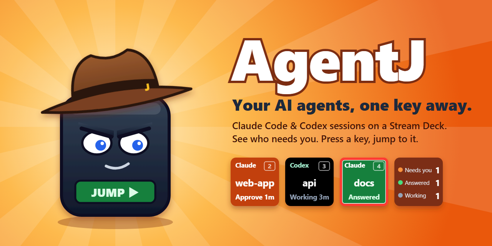
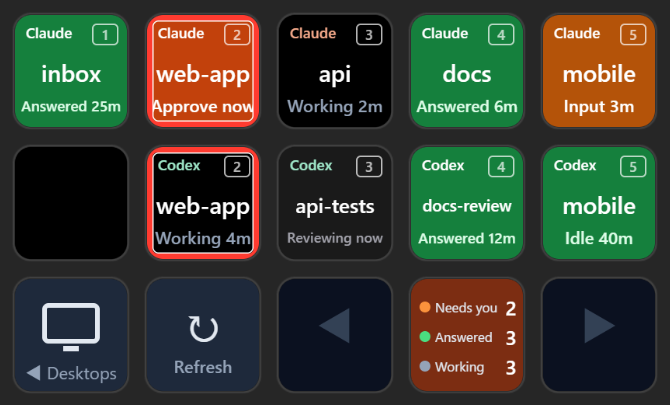
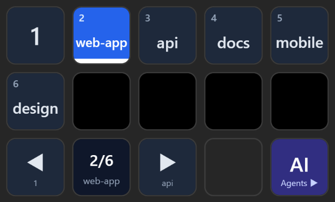

# AgentJ



**Your Claude Code and Codex sessions on a Stream Deck, one key each. Press a key to jump to that session.**

[日本語](README.ja.md)

AgentJ is a plugin for [OpenDeck](https://github.com/nekename/OpenDeck), the open-source Stream Deck app. It is made for
people who run several AI coding agents at once, one project per Windows 11 virtual desktop:

- Every Claude Code / Codex session gets a key showing its name, its desktop and its state: waiting for your approval,
  answered, working, error, and for Claude Code also waiting for input (an MCP form or link) and background (the turn
is over, but a background command or subagent it started is still running). Codex sends no event when
  it asks you a question, so such a Codex session shows as working.
- Press a session's key and Windows switches to the virtual desktop it runs on.
- The summary key counts what needs you, and takes you to the session that has waited longest; press it again for the
  next one.
- Keys for the virtual desktops themselves: one key per desktop with its name, previous / next, current / total.

"J" is for Jump.



*The AI profile. Each column is a virtual desktop (its number top right); the red frame marks the desktop you are on.
`web-app` on desktop 2 waits for your approval, so the summary key counts it under "Needs you".*



*The Desktop profile: one key per virtual desktop, the current one in blue.*

(Both pictures are from OpenDeck's window, with made-up session and desktop names.)

## Requirements

- Windows 11 24H2 (build 26100.2605) or later
- [OpenDeck](https://github.com/nekename/OpenDeck) 2.x and a Stream Deck. The suggested layouts are for 15-key
  (3 x 5) devices; on others, place the keys yourself.
- Claude Code and/or Codex (the Codex desktop app or CLI). Either one is enough.

## Setup

### 1. Install the plugin

Get `AgentJ-<version>-windows-x64.zip` from the [Releases page](https://github.com/Mega-Gorilla/agentj/releases), or
build it yourself (see [Build from source](#build-from-source)). Then either:

- in OpenDeck, install the zip as a plugin from a file, or
- unzip it and put the `io.github.mega-gorilla.agentj.sdPlugin` folder into `%APPDATA%\opendeck\plugins\`, then
  restart OpenDeck.

Put the folder there as a real folder: OpenDeck does not serve icons or settings pages from a plugin folder that is a
link (junction or symlink) to somewhere else.

### 2. Install the hooks

AgentJ learns what each session is doing from Claude Code and Codex hooks. Add them with:

```powershell
& "$env:APPDATA\opendeck\plugins\io.github.mega-gorilla.agentj.sdPlugin\agentj.exe" --install-hooks
```

This adds entries to `~/.claude/settings.json` and `~/.codex/hooks.json` (or under `CODEX_HOME`). Add `claude` or
`codex` at the end to install for one of them only. Other hooks and settings in those files are kept, and a backup of
each changed file is saved next to it as `<file>.bak-<time>`.

**Codex:** approve the AgentJ hooks. In the Codex app, go to **Settings > Hooks**; in the Codex CLI, run `/hooks`.
Codex does not run hooks until they are approved, and asks again whenever a hook's command changes (for example after
the plugin moved).

Claude Code picks the hooks up without a restart.

### 3. Place the keys

In OpenDeck, the actions are under the **AgentJ** category:

| Action | What it does |
|---|---|
| AI Session | One session per key. Press: go to its desktop. Hold: its details (see below). Select the key and choose which tool it is for (Claude Code / Codex) in its settings. |
| AI Summary | How many sessions need you / have answered / are working. Press: go to the next session waiting for you. Hold: choose which tools it jumps to. |
| AI Refresh | Re-read everything now: put each Codex session on the desktop of the ChatGPT window showing it, and clear away sessions that look closed. See the note below. |
| AI Page Previous / Next | Page through the sessions when there are more than keys. |
| Desktop | One virtual desktop per key, numbered in reading order. Press to switch to it. |
| Desktop Info | Current desktop / number of desktops, and its name. |
| Previous Desktop / Next Desktop | Switch to the desktop on the left / right. |

Suggested layouts for a 15-key device, as two profiles. To move between them, use the **Switch Profile** action of
OpenDeck's bundled Starter Pack.

```
AI profile                                  Desktop profile
[Claude] [Claude] [Claude] [Claude] [Claude]    [1]  [2]   [3]  [4] [5]
[Codex]  [Codex]  [Codex]  [Codex]  [Codex]     [6]  [7]   [8]  [9] [10]
[→Desk]  [Refresh] [◀]     [Summary] [▶]        [◀]  [n/N] [▶]  [ ] [→AI]
```

Each column of the AI rows is one virtual desktop: a desktop's Claude Code session sits above its Codex session.

**Holding a session key** turns the session keys into a screen about that session: its state (and since when), its
desktop, folder, what placed it on that desktop, what runs in the background, how many approvals wait, and when it last
did something. Two keys act on it: **Jump** goes to it, **Hide** takes it off the deck (for a tab you have closed or no
longer need; the session itself goes on, and it comes back as soon as it does something). The summary key becomes
**Close**, and Refresh and the page keys go dark until the screen closes. It also closes after 20 seconds without a
press.

**How AI Refresh finds Codex sessions.** Every ChatGPT window is titled just "ChatGPT", so to see which thread each
one shows, Refresh reads the windows through Windows UI Automation (the accessibility interface). After that, the
ChatGPT app keeps its accessibility data up to date, which may cost it a little speed. AgentJ reads the windows only
when you press Refresh.

**AI Refresh and sessions without a window.** Refresh judges a session closed when no app window shows it: no
Claude window titled with its name, no ChatGPT window showing its thread. So a Codex thread you switched away from in
the ChatGPT app is cleared too; it comes back as soon as it does something again. Sessions that are working or
waiting for you always stay. A session you run in a terminal (Claude Code or Codex CLI) has no such window, so Refresh clears it even
while it is open, unless it is working or waiting. It comes back with its next event, but an answer you have not read
yet is no longer shown until then.

### 4. Check it works

Send a prompt in Claude Code or Codex. Within a moment its key shows the session's name and **Working**, then
**Answered** when it is done.

A session shows up once AgentJ knows its virtual desktop. It learns this from the window you send a prompt from, or,
for the Claude desktop app, from the window titled with the session's name.

## Uninstall

1. Remove the hooks:

   ```powershell
   & "$env:APPDATA\opendeck\plugins\io.github.mega-gorilla.agentj.sdPlugin\agentj.exe" --uninstall-hooks
   ```

2. Remove the plugin in OpenDeck.
3. Delete `%LOCALAPPDATA%\AgentJ` (session list, settings and log) if you no longer want them.

## Troubleshooting

| Problem | What to do |
|---|---|
| Codex sessions do not change | Approve the hooks: Codex app **Settings > Hooks**, or `/hooks` in the Codex CLI. |
| A session does not appear, or is on the wrong desktop | Press **AI Refresh**, or send a prompt from that session's window. |
| A session that was closed stays on a key | Press **AI Refresh**, or hold its key and press **Hide**. |
| A terminal session disappeared after AI Refresh | Expected: see [the note on AI Refresh](#3-place-the-keys). It comes back with its next event. |
| The keys work but show nothing | Restart OpenDeck. |
| Something else | See the log, `%LOCALAPPDATA%\AgentJ\agentj.log` (`agentj.prev.log` is the previous run). |

## Privacy

The hooks send events only to AgentJ on this computer (`127.0.0.1:47811`). They do not pass on prompts, answers or
tool input; to tell tool calls apart, they send a hash of the tool input instead. AgentJ reads session names from the
agents' own files on this computer and sends nothing over the network.

## Build from source

Needs [Rust](https://rustup.rs/) 1.88 or later and PowerShell 7 (`pwsh`).

```powershell
git clone https://github.com/Mega-Gorilla/agentj.git
cd agentj
cargo test --release
pwsh tools\package.ps1
```

`package.ps1` builds the release binaries and writes the plugin folder and the zip to `dist\`. Install the zip as in
[step 1](#1-install-the-plugin).

How AgentJ works inside, and notes for development, are in [docs/internals.ja.md](docs/internals.ja.md) (Japanese).

## License

AgentJ is free software, licensed under the GNU General Public License, version 3 or (at your option) any later
version (GPL-3.0-or-later). See [LICENSE](LICENSE).

AgentJ is not affiliated with Elgato, Anthropic or OpenAI. Stream Deck is a trademark of Corsair Memory, Inc.; Claude
is a trademark of Anthropic; Codex is a trademark of OpenAI.
